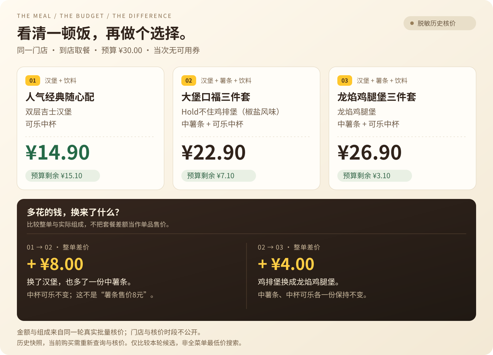

[](https://sam-hui-dot.github.io/mcd-budget-meal/)

    

<h3 align="center">预算你来定，餐单摆出来，多花的钱看明白。</h3>

<p align="center">基于麦当劳中国 MCP 的点餐决策 Skill。<br>说出预算和想吃的餐品，比较最多三份官方核价后的餐单，选好再去点。</p>

<p align="center"><a href="#先看效果">先看效果</a> · <a href="#真实案例">真实案例</a> · <a href="#安装使用">安装使用</a> · <a href="#如何工作">如何工作</a> · <a href="#使用问答">使用问答</a> · <a href="#欢迎与支持">欢迎来坐坐</a></p>

<p align="center">
  <a href="https://sam-hui-dot.github.io/mcd-budget-meal/"><b>🍔 打开免 Token 体验</b></a> ·
  <a href="#安装使用"><b>开始使用 Skill</b></a> ·
  <a href="https://github.com/Sam-Hui-dot/mcd-budget-meal/issues">💬 留个建议</a> ·
  <a href="https://github.com/Sam-Hui-dot/mcd-budget-meal"><b>⭐ 喜欢的话，点颗 Star</b></a>
</p>

## 先看效果

**多少钱、还剩多少、多花的钱换来了什么。** 适合想控制一餐预算、又不想反复切换菜单和优惠页面的单人到店取餐用户。

| 你现在想做什么 | 从这里开始 |
|---|---|
| **先看看选餐过程** | [打开在线体验](https://sam-hui-dot.github.io/mcd-budget-meal/)：调预算，切换已核价的饮料版本，复制结果 |
| **看看每轮生成的报告** | [打开交互报告示例](https://sam-hui-dot.github.io/mcd-budget-meal/example-report.html)：预算筛选、组成对比、整单差价 |
| **用自己的门店和当前价格** | [安装 Skill](#安装使用)，连接自己的麦当劳 MCP |

前两项免安装、免 Token，使用脱敏历史快照，不实时查价或下单。

[](https://sam-hui-dot.github.io/mcd-budget-meal/example-report.html)

图中来自同一轮真实批量核价，当次没有可用券；门店与核价时段已脱敏。它们是历史价格，当前购买需要重新查询。比较只覆盖本轮三份候选，不代表全菜单最低价。[批量运行摘要](examples/batch-verification.md)

**想自己调预算？** 下载后双击 [脱敏交互报告](docs/example-report.html)，可以调整预算、比较组成与差价、复制结果。也保留了 [饮料切换预览](docs/preview.html)，可切换当次已核价的饮料版本。两者均免Token、可单文件打开；GitHub文件链接显示源码，需下载后打开。

每次真实核价指定新的 `--records-dir` 后，会为**本轮成功的报价**生成 `meal-report.html`，可以调预算、看差价、复制结果。[报告使用说明](docs/report-guide.md)

## 真实案例

> 一个人，现在到店取餐，预算30元，想吃一个汉堡和一杯饮料，先让我选门店。

麦麦预算餐会查询所选门店的菜单、可用券和套餐详情，对最多三份候选逐一核价，展示整单应付、实际餐品与份数、剩余预算和优惠条件。

上图三份餐单的官方核价分别为 **¥14.90、¥22.90、¥26.90**。把大堡口福三件套的可乐换成无糖可口可乐后，对**整个餐单重新核价**，那次仍为 ¥22.90。价格相同来自另一份官方返回，不是用菜单差价推算。[批量运行记录](examples/batch-verification.md) · [早期单工具记录](examples/verified-run.md)

| 还可以这样问 | 它会处理什么 |
|---|---|
| “不要可乐，汉堡保留” | 检查排除项，替换后对完整餐单重新核价 |
| “25元，至少两个汉堡” | 检查实际份数；没有预算内方案时明确显示超额 |
| “有券就比较，没有券也行” | 核实当前门店可用券；没有券时比较不带券方案 |

## 安装使用

需要支持远程MCP的AI客户端，例如WorkBuddy、Cherry Studio或Cursor，以及你自己的麦当劳MCP Token。配套脚本需要Python 3.10及以上，使用标准库，无第三方依赖。

1. 到[麦当劳MCP平台](https://open.mcd.cn/mcp)登录、激活Token，按[官方指南](https://github.com/M-China/mcd-mcp-server#2-快速开始)连接 `https://mcp.mcd.cn`，协议为Streamable HTTP。Token只填在客户端私有配置中。
2. 下载并解压仓库。WorkBuddy可在仓库目录运行 `./install.ps1`，或让客户端把完整的 `skills/mcd-budget-meal` 文件夹导入技能目录。已有技能会先备份；安装脚本不读取Token、不修改连接器。
3. 新开客户端会话，发送：

```text
使用麦麦预算餐技能。一个人，现在到店取餐，预算30元，想吃一个汉堡和一杯饮料。
先让我选门店，再比较最多三份真实核价的餐单。不下单。
```

客户端没有Skill导入入口时，打开仓库目录，让AI读取 `skills/mcd-budget-meal/SKILL.md`。只使用原生MCP工具时，脚本可选；WorkBuddy核价若遇到数组校验问题，需要本机Python使用项目直连路径。

[详细点击步骤与常见问题](docs/quick-start.md) · [WorkBuddy兼容说明](skills/mcd-budget-meal/references/workbuddy-compatibility.md)

## 如何工作


AI负责理解需求、查询真实菜单和准备候选；官方 `calculate-price` 返回整单应付金额；本地脚本按整数分检查预算、份数、排除项、核价时间与重复餐单。

| 选餐时容易卡住的地方 | 项目怎样处理 |
|---|---|
| 看得到套餐价，却不清楚实际组成 | 核对套餐轮次、替换项与实际数量，展示餐品必须与核价请求一致 |
| 换了饮料，还在沿用旧价格 | 每次修改餐单都重新核价；不拿展示价加减旧报价 |
| 两份餐单只差几元，不知道值在哪里 | 列出增加、减少与不变的餐品；整单差价不当作单品售价 |
| 没有预算内方案 | 显示最接近的有效餐单和超出金额，由你决定是否调整 |
| 后面的接口失败，前面的结果也丢了 | 停止后续请求，保留已成功报价及失败原因，不自动重试 |
| 核价成功，报告文件却导出失败 | 终端仍保留有效结果，可从保存的比较 JSON 离线恢复历史报告 |

仅支持同一门店、单人、现在到店取餐，停在餐单建议阶段。比较只覆盖本轮候选，不保证全菜单最低价。营养、配料与过敏原未纳入推荐规则；价格、可售状态和券适用性以官方当前结果为准。

[实际工具、参数和业务价值](MCP_INTEGRATION.md) · [批量餐单计划](skills/mcd-budget-meal/references/meal-plan.md) · [本地报价格式](skills/mcd-budget-meal/references/quote-format.md)

## 使用问答

<details>
<summary><b>这是 Skill，为什么还有网页？</b></summary>

Skill 在 AI 客户端里查菜单和核价；网页用来查看比较结果。在线体验是免 Token 的历史示例，真实运行则生成自己的本地报告。网页本身不会登录麦当劳或替你点餐。

</details>

<details>
<summary><b>必须用 WorkBuddy 吗？核价报数组错误怎么办？</b></summary>

支持远程 MCP、能读取技能说明的客户端都可以使用。WorkBuddy 原生入口出现已知数组校验问题时，项目提供连接同一官方服务的 Python 直连路径；按[兼容说明](skills/mcd-budget-meal/references/workbuddy-compatibility.md)操作，不需要反复删连接器。配套脚本需要本机 Python。

</details>

<details>
<summary><b>没有券、预算太低，或者只想换饮料呢？</b></summary>

没有券时正常比较不带券餐单；全部超预算时显示最接近的有效方案和超额。换饮料需要先确认门店实际可替代项，再重新核价整单；历史演示页只能切换已经核价的版本。

</details>

<details>
<summary><b>Token 和私人信息会保存在哪里？</b></summary>

认证只从用户自己的私有配置或环境变量读取，项目不提供 Token 代理。直连脚本只允许门店、菜单、券、套餐详情和价格查询，认证只发送到固定官方端点，并拒绝重定向。

原始请求、响应与私人报告留在本机 `private/`，该目录已被 Git 忽略。公开案例隐藏门店与核价时段；你自己生成的私人报告仍含实际门店和时间，分享前请脱敏。

</details>

## 验证记录

下表为各版本已保存的验证结果，不是自动运行的 CI 状态。

| 范围 | 已记录的验证 |
|---|---|
| 真实MCP运行 | 批量入口完成三份核价、自动生成报告；另行换饮料核价成功。公开摘要已脱敏 |
| Python逻辑 | 51项纯离线回归，含导出失败保留有效报价、旧比较JSON恢复及原有预算检查 |
| 页面逻辑 | 14组模拟DOM场景通过，含复制回退、旧结果清理、报价过期与历史恢复标注 |
| 安装升级 | 临时配置目录14项检查通过，含去除旧文件、保留私人记录与替换失败恢复旧版 |

带券分支尚无真实账户案例。安装验收使用隔离的临时配置目录，未安装到用户真实WorkBuddy目录、未验证WorkBuddy自动发现技能。默认15分钟的报价新鲜度是项目自己的展示策略。[本轮验证与使用说明](docs/report-guide.md)

<details>
<summary><b>开发命令与模拟输出</b></summary>

纯离线回归：

```powershell
python -B -m unittest discover -s tests -v
node tests/check_report.cjs
./tests/test_install.ps1
```

Node只用于页面开发验收，使用Skill和Python脚本不需要安装Node。

查看模拟输出（以下数据为虚构示例）：

```powershell
python skills/mcd-budget-meal/scripts/compare_meals.py examples/demo-quotes.json
```

</details>

公开配置 [`mcp-config.example.json`](mcp-config.example.json) 仅含 `${MCD_MCP_TOKEN}` 占位符。真实凭证和原始响应保存在本机私有目录。公开案例隐藏门店和核价时段；自己生成的私人报告仍含本轮门店、餐品与时间，分享前请先脱敏。

[版本说明](CHANGELOG.md) · [WorkBuddy实际参与记录](workbuddy.md) · [本轮视觉设计与插画说明](docs/visual-design.md)

## 项目入口

| 文件 | 用途 |
|---|---|
| [`skills/mcd-budget-meal/SKILL.md`](skills/mcd-budget-meal/SKILL.md) | 选店、候选准备与核价的对话流程 |
| [`skills/mcd-budget-meal/scripts/quote_meals.py`](skills/mcd-budget-meal/scripts/quote_meals.py) | 最多三份候选的请求校验、官方核价与预算比较 |
| [`skills/mcd-budget-meal/scripts/compare_meals.py`](skills/mcd-budget-meal/scripts/compare_meals.py) | 不联网的金额与偏好检查、排序及Markdown输出 |
| [`skills/mcd-budget-meal/scripts/report_meals.py`](skills/mcd-budget-meal/scripts/report_meals.py) | 把有效报价生成独立交互报告，只提取展示字段 |
| [`docs/example-report.html`](docs/example-report.html) | 批量入口真实报价的脱敏报告示例 |
| [`docs/preview.html`](docs/preview.html) | 历史核价效果预览，免Token |

## 欢迎与支持


做这个小工具，是希望“预算多少、想吃什么”能更容易得到一个明白的答案。谢谢你愿意花时间看看它，也希望它能帮你少一点纠结，多一点好好吃饭的轻松。

| 来做点什么 | 从这里开始 |
|---|---|
| **先试试效果** | [打开免安装体验](https://sam-hui-dot.github.io/mcd-budget-meal/)，调整预算、看看餐单差价 |
| **告诉我哪里还能更好** | [提交 Issue](https://github.com/Sam-Hui-dot/mcd-budget-meal/issues)，聊聊使用感受、问题或想要的功能 |
| **一起动手改进** | 欢迎提交 PR；修一个小问题、补一段说明也很有帮助 |
| **让更多人发现它** | 分享 [仓库链接](https://github.com/Sam-Hui-dot/mcd-budget-meal) 或 [在线体验](https://sam-hui-dot.github.io/mcd-budget-meal/)，喜欢的话点亮右上角的 **Star ⭐** |

每一次真实的使用和反馈，都是继续改进的动力。分享问题时，记得隐藏 Token、手机号、门店位置和核价时段。

<p align="center"><b>谢谢你的支持。祝你每一餐都合心意，想做的事也一点点有进展。🍟</b></p>

## 许可与声明

原创Skill、脚本和示例使用[MIT License](LICENSE)。官方[参赛声明](CONTEST_DECLARATION.md)保留原文。本项目是参赛者作品，非麦当劳官方产品；使用MCP须遵守官方服务规则。封面插画是原创生成素材，不代表具体在售餐品。
