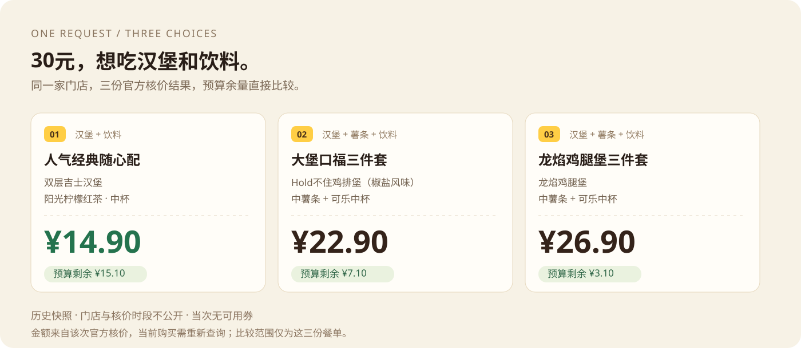

    

**输入预算和想吃的餐品，把官方核价后的餐单放在一起选。**

[先看效果](#先看效果) · [真实案例](#真实案例) · [安装使用](#安装使用) · [如何工作](#如何工作) · [验证记录](#验证记录)

## 先看效果

**[打开在线体验 →](https://sam-hui-dot.github.io/mcd-budget-meal/)**　免安装、免Token，调整预算、查看差价和已核价的饮料版本。页面使用历史核价记录，不实时查价或下单。

[查看10月16日批量入口生成的真实报告](https://sam-hui-dot.github.io/mcd-budget-meal/example-report.html) · [报告使用说明](docs/report-guide.md)



这是2026年10月11日深圳南科大餐厅的一次真实核价记录，当次没有可用券。价格为历史快照，当前购买需要重新查询与核价。

**想自己调预算？** 下载后双击 [10月16日批量入口生成的交互报告](docs/example-report.html)，可以调整预算、比较组成与差价、复制结果。也保留了 [10月11日历史预览](docs/preview.html)，可切换当次已核价的饮料版本。两者均免Token、可单文件打开；GitHub文件链接显示源码，需下载后打开。

每次真实核价指定 `--records-dir` 后，也会自动生成属于你本轮结果的 `meal-report.html`，不再只依赖固定的示例页面。[新一轮真实运行记录](examples/verified-run-2026-10-16.md)

## 真实案例

> 一个人，现在到店取餐，预算30元，想吃一个汉堡和一杯饮料，先让我选门店。

麦麦预算餐会查询所选门店的菜单、可用券和套餐详情，对最多三份候选逐一核价，展示整单应付、实际餐品与份数、剩余预算和优惠条件。

那次三份餐单的官方核价分别为 **¥14.90、¥22.90、¥26.90**。随后把大堡口福三件套的可乐换成无糖可口可乐，重新核价整个餐单，得到 **¥22.90**。[查看完整运行记录](examples/verified-run.md)

| 还可以这样问 | 它会处理什么 |
|---|---|
| “不要可乐，汉堡保留” | 检查排除项，替换后对完整餐单重新核价 |
| “25元，至少两个汉堡” | 检查实际份数；没有预算内方案时明确显示超额 |
| “有券就比较，没有券也行” | 核实当前门店可用券；没有券时比较不带券方案 |

## 安装使用

需要支持远程MCP的AI客户端，例如WorkBuddy、Cherry Studio或Cursor，以及你自己的麦当劳MCP Token。配套脚本需要Python 3.10及以上，使用标准库，无第三方依赖。

1. 到[麦当劳MCP平台](https://open.mcd.cn/mcp)登录、激活Token，按[官方指南](https://github.com/M-China/mcd-mcp-server#2-快速开始)连接 `https://mcp.mcd.cn`，协议为Streamable HTTP。Token只填在客户端私有配置中。
2. 下载并解压仓库。WorkBuddy可在仓库目录运行 `./install.ps1`，或让客户端把完整的 `skills/mcd-budget-meal` 文件夹导入技能目录。已有技能会先备份；安装脚本不读取Token、不修改连接器。
3. 新开客户端会话，发送：

```text
使用麦麦预算餐技能。一个人，现在到店取餐，预算30元，想吃一个汉堡和一杯饮料。
先让我选门店，再比较最多三份真实核价的餐单。不下单。
```

客户端没有Skill导入入口时，打开仓库目录，让AI读取 `skills/mcd-budget-meal/SKILL.md`。只使用原生MCP工具时，脚本可选；WorkBuddy核价若遇到数组校验问题，需要本机Python使用项目直连路径。

[详细点击步骤与常见问题](docs/quick-start.md) · [WorkBuddy兼容说明](skills/mcd-budget-meal/references/workbuddy-compatibility.md)

## 如何工作


AI负责理解需求、查询真实菜单和准备候选；官方 `calculate-price` 返回整单应付金额；本地脚本按整数分检查预算、份数、排除项、核价时间与重复餐单。

- **预算以你的输入为准**：没有预算内方案时，列出最接近的有效餐单与超出金额。
- **更换餐品后重新核价**：不拿旧报价加减菜单展示价。
- **接口失败就停止本轮后续调用**：保留此前的有效结果，不自动重试。
- **差价说清楚**：分别列出增加、减少与保持不变的餐品和份数；整单差价不当作新增餐品的单独售价。
- **报告随本轮核价生成**：预算筛选、差价和复制使用本轮实际成功报价；失败候选不生成猜测价格。

仅支持同一门店、单人、现在到店取餐，停在餐单建议阶段。比较只覆盖本轮候选，不保证全菜单最低价。营养、配料与过敏原未纳入推荐规则；价格、可售状态和券适用性以官方当前结果为准。

[实际工具、参数和业务价值](MCP_INTEGRATION.md) · [批量餐单计划](skills/mcd-budget-meal/references/meal-plan.md) · [本地报价格式](skills/mcd-budget-meal/references/quote-format.md)

## 验证记录

| 范围 | 已记录的验证 |
|---|---|
| 真实MCP运行 | 2026-10-16批量入口完成三份核价、自动生成报告；另行换饮料核价成功。初版10月11日记录保留 |
| Python逻辑 | 42项纯离线回归，覆盖原有预算检查、差价、报告字段筛选、HTML转义与错误诊断 |
| 页面逻辑 | 新版13组模拟DOM场景通过，含复制拒绝、手动回退、异步旧结果清理与报价过期 |

带券分支尚无真实账户案例；安装脚本未实际安装验证。默认15分钟的报价新鲜度是项目自己的展示策略，过期报告保留记录并提示重新核价。[本轮验证与使用说明](docs/report-guide.md)

纯离线回归：

```powershell
python -B -m unittest discover -s tests -v
node tests/check_report.cjs
```

Node只用于页面开发验收，使用Skill和Python脚本不需要安装Node。

查看模拟输出（以下数据为虚构示例）：

```powershell
python skills/mcd-budget-meal/scripts/compare_meals.py examples/demo-quotes.json
```

公开配置 [`mcp-config.example.json`](mcp-config.example.json) 仅含 `${MCD_MCP_TOKEN}` 占位符。真实凭证、原始响应和个人信息只保存在本机私有目录，不上传仓库。

[版本说明](CHANGELOG.md) · [WorkBuddy实际参与记录](workbuddy.md) · [本轮视觉设计与插画说明](docs/visual-design.md)

## 项目入口

| 文件 | 用途 |
|---|---|
| [`skills/mcd-budget-meal/SKILL.md`](skills/mcd-budget-meal/SKILL.md) | 选店、候选准备与核价的对话流程 |
| [`skills/mcd-budget-meal/scripts/quote_meals.py`](skills/mcd-budget-meal/scripts/quote_meals.py) | 最多三份候选的请求校验、官方核价与预算比较 |
| [`skills/mcd-budget-meal/scripts/compare_meals.py`](skills/mcd-budget-meal/scripts/compare_meals.py) | 不联网的金额与偏好检查、排序及Markdown输出 |
| [`skills/mcd-budget-meal/scripts/report_meals.py`](skills/mcd-budget-meal/scripts/report_meals.py) | 把有效报价生成独立交互报告，只提取展示字段 |
| [`docs/example-report.html`](docs/example-report.html) | 10月16日批量入口真实报价的报告示例 |
| [`docs/preview.html`](docs/preview.html) | 历史核价效果预览，免Token |

## 许可与声明

原创Skill、脚本和示例使用[MIT License](LICENSE)。官方[参赛声明](CONTEST_DECLARATION.md)保留原文。本项目是参赛者作品，非麦当劳官方产品；使用MCP须遵守官方服务规则。封面插画是原创生成素材，不代表具体在售餐品。
